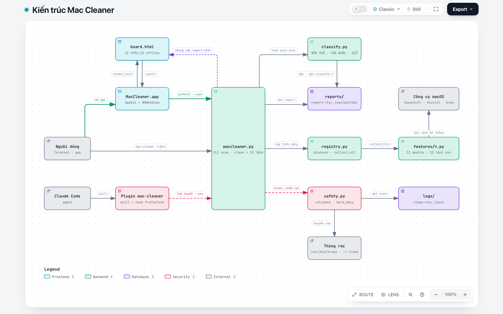

# Mac Cleaner

Kiểm kê toàn bộ máy macOS và dọn dẹp an toàn — lõi Python thư viện chuẩn, không `sudo`:

- **Kiểm kê + dọn:** ứng dụng, plugin (thuộc app nào), extension (editor + trình duyệt), git (binary + mọi repo), cache, log,
  junk (build artifact, installer, backup cũ, leftover của app đã gỡ, simulator hỏng), rác hệ thống/trình duyệt mở rộng.
- **Ứng dụng:** gỡ app kèm file liên quan, app lâu không mở, bản cập nhật (Sparkle, Homebrew cask, macOS — chỉ liệt kê).
- **Dung lượng:** bản đồ thư mục, file lớn lâu không dùng, file trùng, thư mục cloud (bản local vs chỉ còn trên cloud).
- **Hệ thống:** sức khoẻ máy (ổ, RAM, CPU, pin, mạng), mục khởi động, phần mềm bám trụ + chữ ký mã, quyền riêng tư (TCC), bảo trì cấp user.
- **Phân loại sau quét:** NÊN XOÁ / CÂN NHẮC / GIỮ kèm "xoá thì sao".

Mỗi mục có đường dẫn, app sở hữu, phiên bản, dung lượng và mức an toàn. Mặc định chỉ xem trước; xoá = chuyển vào Thùng rác, có log.
Dùng qua dòng lệnh, app desktop (dashboard có sidebar, KPI, biểu đồ, drawer) hoặc plugin Claude Code.

## Cài (máy Mac bất kỳ, macOS 13+, Apple Silicon hoặc Intel)

```sh
git clone https://github.com/KmSlime/mac-cleaner.git && cd mac-cleaner && ./install.sh
```

`install.sh` không dùng `sudo`, chạy lại được nhiều lần:

| Bước | Làm gì |
|---|---|
| Command Line Tools | Thiếu thì mở trình cài chính thức của Apple (cho Python 3 + Swift); cài xong chạy lại `./install.sh` |
| App **Mac Cleaner** | Build Universal từ source → `~/Applications/MacCleaner.app`. Thiếu Python 3 thì app tự hỏi và mở trình cài |
| Lệnh `mac-cleaner` | `~/.local/bin/mac-cleaner` — dùng chung report với app (`~/Library/Application Support/MacCleaner`) |
| Plugin Claude Code | Có `claude` thì cài plugin `mac-cleaner` (skill `mac-cleaner`, hook xin duyệt) từ chính repo; không có thì bỏ qua |

Tuỳ chọn: `--no-app`, `--no-plugin`. Chỉ cần app: tải `.zip` ở trang Releases.
Chỉ cần skill trong Claude Code: `/plugin marketplace add KmSlime/mac-cleaner` rồi `/plugin install mac-cleaner@mac-cleaner`.

## Chạy

```sh
python3 maccleaner.py scan                       # quét → reports/report-<ts>.{html,md,json}, rồi chạy hooks/post-scan/*
python3 scripts/classify.py --report latest      # phân loại report: NÊN XOÁ / CÂN NHẮC / GIỮ + "xoá thì sao"
python3 scripts/classify.py --fs                 # quét TOÀN BỘ hệ thống file từ / (gốc → lá, không sudo)
python3 scripts/classify.py --fs --root ~/Library --root ~/Developer --out reports   # theo boundary, ghi classify-<ts>.{md,json}
open reports/report-*.html                       # report tĩnh (tick chọn → copy lệnh dọn)
python3 maccleaner.py clean                      # preview: mọi mục "an toàn" của report mới nhất
python3 maccleaner.py clean --category caches --yes          # dọn thật một nhóm
python3 maccleaner.py clean --ids a1b2c3d4e5,... --yes       # dọn đúng các id (lấy từ report/app)
python3 maccleaner.py clean --include-review ...             # gồm cả mục "cân nhắc"
python3 maccleaner.py clean --ids <id> --force --yes          # xoá đích danh cả mục kiểm kê/bảo vệ (app, repo, plugin…)
python3 maccleaner.py clean --category junk:app-cache --yes # dọn mục của một tính năng (<tính năng>:<kind>)

# Tính năng (mclib/features/) — mặc định chỉ đọc / xem trước; chỉ --yes mới làm thật (hook bắt hỏi duyệt)
python3 maccleaner.py status [--json]                       # sức khoẻ máy: ổ, RAM/swap, CPU, pin, mạng, thiết bị, cảnh báo
python3 maccleaner.py junk                                  # rác hệ thống mở rộng: cache trình duyệt/app, log container, plist hỏng…
python3 maccleaner.py uninstall <tên|bundle id|.app> [--yes] # gỡ app kèm file liên quan (→ Thùng rác) · --list: app lâu không mở
python3 maccleaner.py updates [--offline]                   # bản cập nhật app (Sparkle, Homebrew cask) + macOS — không cài
python3 maccleaner.py analyze [path] [--depth 3]            # bản đồ dung lượng
python3 maccleaner.py large [path…] --min 500M --older 180d # file lớn và lâu không dùng
python3 maccleaner.py dupes [path…] --min-size 5M           # file trùng (luôn giữ một bản mỗi nhóm)
python3 maccleaner.py cloud                                 # iCloud/Dropbox/…: bản local vs chỉ còn trên cloud
python3 maccleaner.py startup list | disable|enable <label> [--yes]  # mục khởi động (LaunchAgent, login item)
python3 maccleaner.py audit [--gatekeeper]                  # phần mềm bám trụ + chữ ký mã (mặc định offline)
python3 maccleaner.py privacy list | reset <dịch vụ> <bundle id> [--yes]  # dấu vết trình duyệt, quyền TCC
python3 maccleaner.py maintain list | run <tác vụ> [--yes]  # bảo trì cấp user; tác vụ cần sudo chỉ in lệnh

swift run MacCleaner                             # app desktop: quét lại, chọn, xem trước, dọn ngay trong UI
swift run MacCleaner --snapshot x.png            # render report mới nhất ra ảnh rồi thoát
./scripts/make-app.sh && open build/MacCleaner.app
TMPDIR=/tmp python3 -m unittest discover tests   # unit test
```

Yêu cầu: macOS 13+, Python 3.9+ (chỉ thư viện chuẩn), Swift 5.9+ cho app. Không có dependency ngoài.
App `.app` ghi report/log vào `~/Library/Application Support/MacCleaner`; `swift run`/CLI ghi cạnh source (`reports/`, `logs/`, đã gitignore).

## Kiến trúc

<picture>
  <source media="(prefers-color-scheme: dark)" srcset="docs/architecture/architecture-dark.png">
  
</picture>

Bản tương tác (có liên kết tới từng dòng mã nguồn): [docs/architecture/architecture.html](docs/architecture/architecture.html) — tải về rồi mở bằng trình duyệt.

- Ba lối vào cùng một lõi `maccleaner.py`: lệnh `mac-cleaner` trong Terminal, app Swift (WKWebView hiện `board.html`, cầu JS `post()` chạy `python3 maccleaner.py … --json`), và plugin Claude Code (hook `PreToolUse` bắt hỏi duyệt mọi lệnh `--yes`).
- `scan` quét các nhóm gốc, rồi `registry.py` nạp từng file `mclib/features/*.py` (lệnh con + `report["features"]`); tính năng đọc trạng thái máy qua công cụ macOS (`launchctl`, `sfltool`, `tccutil`, Spotlight, `brew`, `softwareupdate`…).
- Report ghi ra `reports/report-<ts>.{json,md,html}` (HTML nhúng `board.html`), sau đó hook `post-scan` chạy `classify.py`.
- `clean` và `uninstall --yes` đi qua `safety.py`: kiểm lại từng mục lúc chạy, chặn cứng SIP/thư mục gốc/phần mềm bảo mật, chuyển vào Thùng rác và ghi `logs/clean-<ts>.jsonl`. Các lệnh đổi trạng thái khác (`startup`, `privacy reset`, `maintain run`) chỉ chạy khi có `--yes`.

## Mục lục

Sidebar là cây mục lục: **Tổng quan** → từng nhóm (Ứng dụng, Plugin, Extension, Git, Cache & log, Junk) → từng loại bên trong (vd Cache & log › Log, Cache người dùng, Xcode DerivedData…), mỗi nút có số mục và dung lượng. Khu **Tính năng** liệt kê kết quả của `mclib/features/` trong report (sức khoẻ máy, rác hệ thống, dung lượng, file trùng, cloud, gỡ app, cập nhật, khởi động, bám trụ, riêng tư, bảo trì); lệnh đổi trạng thái máy chỉ hiện để copy chạy trong Terminal. Bấm mũi tên để mở/thu gọn, bấm tên để xem. Bấm bất kỳ chỗ nào trên trang dẫn tới danh sách (một loại trong cây, một thanh biểu đồ, thẻ KPI, một app trong "App chiếm cache", một app trong "Plugin theo app", tiêu đề các thẻ) thì bảng được lọc và **trang cuộn tới bảng**. Bộ lọc đang bật hiện thành chip phía trên bảng, bấm ✕ để bỏ.

## Xoá

**Mọi mục hiện trên dashboard đều xoá được**, trừ những chỗ macOS khoá: phần hệ thống được SIP bảo vệ (`/System`, `/usr` ngoài `/usr/local`, `/bin`, `/sbin` — app và plugin có sẵn của macOS), thư mục gốc (`/Applications`, `~`, `~/Documents`, `~/Library`…), và thư mục Mac Cleaner đang chạy trên đó. Những mục này có nút xoá mờ kèm lý do.

- **Từng mục:** nút **🗑** trên mỗi dòng của bảng, của "Lớn nhất" và "Git repos" (nút **ⓘ** để xem chi tiết). Hộp thoại có đường dẫn, loại, dung lượng, cách xoá, **Xem trước** và **Hiện trong Finder**. Mục `an toàn` xoá ngay; mục `cân nhắc` phải tick xác nhận; mục `kiểm kê`/`bảo vệ` (app, repo, plugin, backup mới nhất…) phải tick xác nhận và có cảnh báo theo loại (repo còn thay đổi chưa commit, plugin trong bundle app khác, app cài bằng quyền admin…).
- **Cả nhóm:** nút 🗑 cạnh mỗi app trong "App chiếm cache" (mọi cache của app đó) và "Plugin theo app".
- **Xoá toàn bộ** (cạnh Log, Quét lại): xoá mọi mục đang hiện trong bảng theo nhóm và bộ lọc hiện tại. Mặc định chỉ gồm mục dọn được (`an toàn` + `cân nhắc`); tick thêm để gồm cả mục kiểm kê/bảo vệ.
- **Chọn nhiều:** checkbox trên mỗi dòng → thanh dưới đáy có **Xem trước** và **Xoá → Thùng rác**.
- **Thùng rác:** mục Thùng rác trong Junk có nút **Đổ Thùng rác** riêng (xoá vĩnh viễn, phải tick xác nhận; macOS có thể hỏi quyền cho Mac Cleaner điều khiển Finder). Thùng rác không bao giờ gộp vào xoá hàng loạt.

Mọi thứ khác đều **chuyển vào Thùng rác**, khôi phục được cho tới khi đổ. LaunchAgent được ngừng (`launchctl bootout`) trước khi chuyển plist vào Thùng rác. Mỗi mục được kiểm lại ngay trước khi xoá. Trong report HTML tĩnh, nút xoá copy lệnh `clean --ids …` (thêm `--force` nếu có mục kiểm kê) để dán vào Terminal.

## Phân loại sau quét

`scan` xong tự chạy mọi file thực thi trong `hooks/post-scan/` (theo tên, đối số là report JSON; `--no-hooks` để tắt).
Mặc định có `10-classify` → [scripts/classify.py](scripts/classify.py) in bảng tổng và 5 mục NÊN XOÁ lớn nhất, ghi đủ ra `reports/classify-<ts>.{md,json}`.

| Nhóm | Nghĩa |
|---|---|
| **NÊN XOÁ** | tự tạo lại (cache, log, build, dependency, bản cài đã dùng) — xoá chỉ tốn thời gian dựng lại |
| **CÂN NHẮC** | xoá được nhưng có hệ quả: mất trạng thái/đăng nhập/index của app, phải tải lại SDK/simulator, dữ liệu app không còn dùng, đổ Thùng rác là vĩnh viễn. Mỗi mục ghi *xoá thì sao* để người dùng tự quyết |
| **GIỮ** | hệ thống (SIP), dữ liệu người dùng, khoá/bí mật, Homebrew (để `brew` quản), thứ đánh dấu giữ |

- `--fs` đi từ gốc tới lá: thư mục khớp luật cụ thể (`~/Library/Caches`, `*/node_modules`, `*/.build`…) được tính cả cây thành một mục; thư mục chứa (`~`, `~/Library`, `~/Documents`…) và chỗ chưa có luật thì đi tiếp xuống tới `--depth` (mặc định 6). Bỏ qua `/System/Volumes` (Data volume đã thấy qua firmlink), `/Volumes`, `/dev`.
- Danh sách luôn giữ: `--keep PATH` hoặc file `MACCLEANER_KEEP_FILE`. Lịch sử dọn đọc từ `logs/clean-*.jsonl` (+ `MACCLEANER_EXTRA_LOGS`).
- Chỉ đọc, không xoá gì. Dọn vẫn qua `clean --ids … --yes`.

## Terminal log

Nút **Log** (⌘L) mở bảng log ở đáy app: lệnh đang chạy, từng bước quét kèm số mục và thời gian, nhịp báo trong các bước dài (duyệt home, tìm backup trên toàn ổ, đo dung lượng), từng mục khi dọn, và lỗi nếu có. Lần mở đầu tiên (chưa có report) app tự quét và tự mở log. Log cũng ghi ra `~/Library/Application Support/MacCleaner/logs/app-<ngày>.log`; nút **Copy** để gửi khi cần báo lỗi. Nút **Mở Terminal** bật Terminal.app thật, chạy `tail -F` log hiện tại; Ctrl-C để thôi xem và gõ lệnh `mac-cleaner` ngay trong thư mục dữ liệu.

Chạy app với thư mục dữ liệu khác: `MACCLEANER_DATA=/đường/dẫn open -a ~/Applications/MacCleaner.app` (dùng chung biến với lệnh `mac-cleaner`).

## Hook xin duyệt (khi dùng qua Claude Code)

Plugin có hook `PreToolUse`: trước khi agent chạy lệnh **làm thật** — `mac-cleaner clean|uninstall … --yes`, `startup disable|enable … --yes`, `privacy reset … --yes`, `maintain run … --yes`, `mo clean|purge|uninstall|optimize|installer` (nếu bạn tự cài Mole) không kèm `--dry-run`, hay lệnh đụng tới Thùng rác — Claude Code **phải hỏi bạn duyệt**, kể cả ở auto mode. Lệnh xem trước chạy bình thường. Hook không chặn cứng: bạn luôn là người quyết.

## Mức an toàn

| Mức | Ý nghĩa | Ví dụ |
|---|---|---|
| `safe` | dọn không mất dữ liệu, app tự tạo lại | `~/Library/Caches/*` (cache của macOS `com.apple.*` để mức `review`), `~/Library/Logs/*`, cache trong Containers, DerivedData, simulator unavailable, backup cũ (đã có bản mới hơn), extension editor obsolete |
| `review` | dọn được nhưng nên xem | build artifact (node_modules, Pods, .venv…; vừa dùng trong 7 ngày thì để `info`), cache tải lại rất lâu (`ms-playwright`, `JetBrains`), installer .dmg/.pkg/.xip, iOS DeviceSupport, Archives, `~/.cache/*`, bản extension cũ, leftover app (Containers, Preferences, `Application Support/<bundle id>` — chỉ khi không còn app, Spotlight cũng không thấy, và 30+ ngày không được ghi), LaunchAgent mồ côi (chương trình của nó không còn), `/Library/Caches` |
| `info` | kiểm kê (xoá được khi chọn đích danh) | ứng dụng, plugin, extension đang dùng, git, backup mới nhất |
| `protected` | không dọn tự động (chỉ khi chọn đích danh) | cache đang là dữ liệu sống: `~/Library/Caches/pypoetry` (virtualenv), `org.R-project.R` (renv), `com.apple.FontRegistry`, `com.apple.Spotlight`; Keychains, `~/.ssh`, `~/.gnupg`; **mọi thư mục trong `~/Library` ngoài** `Caches`, `Logs`, `Containers`, `Group Containers`, `Preferences`, `Developer` (dữ liệu ứng dụng, thư mục đồng bộ…); **mọi thư mục ẩn ở home ngoài** vùng cache `~/.cache`, `~/.npm`, `~/.gradle/caches` (dữ liệu, model, cấu hình của các tool) |

`clean` **kiểm lại từng mục lúc chạy** (không tin report): phải là `safe`/`review`, còn tồn tại, không protected,
nằm trong `~` (sâu ≥ 2 cấp) hoặc `/Library/Caches`, `/Library/Logs`; lệnh đặc biệt chỉ cho phép `xcrun simctl delete`.
`--force` (chỉ đi kèm `--ids`, tức là chọn đích danh) bỏ qua mức an toàn và vùng bảo vệ nhưng **vẫn chặn cứng**: SIP và
cây hệ thống (`/System`, `/usr` ngoài `/usr/local`, `/etc`, `/var`, `/Library/Keychains`, `/Library/Extensions`…), thư mục gốc
(`/Applications`, `/Library/Application Support`, `/Users/*`, `/Users/Shared`, `/opt/homebrew`…; so sánh không phân biệt hoa thường
vì APFS), **phần mềm bảo mật / quản lý thiết bị** (EDR, MDM — xoá có thể bị coi là can thiệp), và thư mục Mac Cleaner đang dùng;
với mục Thùng rác thì `--force` nghĩa là đổ Thùng rác. Cache của **app đang chạy** được bỏ qua (`skip`) — đóng app rồi dọn.
Dữ liệu trình quản lý mật khẩu, keychain, ssh/gpg, ví, app xác thực không bao giờ bị coi là "sót lại".
Các rào này học từ cách [Mole](https://github.com/tw93/mole) vận hành và được viết lại cho mac-cleaner (không chép mã).
Xoá = **chuyển vào Thùng rác** (`/usr/bin/trash` trên macOS 15+; macOS 13–14 chuyển thẳng vào `~/.Trash`) — khôi phục được; đổ Thùng rác để lấy lại dung lượng. Mỗi lần dọn ghi `logs/clean-<ts>.jsonl`.

## Nguồn dữ liệu

| Nhóm | Nguồn |
|---|---|
| applications | `/Applications`, `~/Applications`, `/System/Applications` — `Info.plist` (tên, version, bundle id), App Store / thủ công / macOS |
| plugins | `pluginkit -mAvvv` (app extension + app cha), `{/,~/}Library/{Internet Plug-Ins, Audio/Plug-Ins, QuickLook, Spotlight, PreferencePanes, Input Methods, Services, …}`, `systemextensionsctl list` |
| extensions | `~/.<editor>/extensions/*/package.json` (mọi editor lưu extension theo kiểu này), `<Chromium browser>/<profile>/Extensions/<id>/<ver>/manifest.json` |
| git | `which -a git`, mọi thư mục có `.git` trong `~` (bỏ Library, node_modules, cache…) và `/opt/homebrew` — branch, remote, số file dirty, commit cuối, dung lượng `.git` |
| caches | `~/Library/{Caches,Logs}`, `~/Library/Containers/*/Data/Library/Caches`, `/Library/{Caches,Logs}`, Xcode DerivedData/DeviceSupport/Archives, `simctl list devices unavailable`, `~/.npm`, `~/.gradle/caches`, `~/.cache/*`… |
| junk | build artifact khi đi qua `~`, installer trong Downloads/Desktop/Documents, file backup trên toàn volume Data (`find -x`, gom theo thư mục + tên gốc, giữ bản mtime mới nhất), Containers/Preferences không khớp bundle id nào đang cài, Thùng rác |

Tính năng trong `mclib/features/` đọc thêm: `launchctl`/`sfltool dumpbtm` (khởi động — lệnh này hỏi mật khẩu admin nên kết quả được nhớ ở `~/Library/Application Support/MacCleaner/dumpbtm-cache.json`, chỉ hỏi lại khi CSDL login item của macOS đổi; xoá file để hỏi lại), `codesign -dv`/cờ quarantine (bám trụ), TCC.db của user (quyền), Spotlight `kMDItemLastUsedDate` (app lâu không mở), appcast Sparkle + `brew outdated --cask` + `softwareupdate -l` (cập nhật), `st_blocks`/`SF_DATALESS` (dung lượng, cloud). Đối chiếu với CleanMyMac: `docs/CLEANMYMAC-PARITY.md`.

## Giới hạn đã biết

- Không dùng `sudo`: `/Library/Caches` của root và cache hệ thống có thể từ chối; Thùng rác cần Full Disk Access cho terminal để đo.
- "Leftover" dựa trên bundle id của app + plugin đang cài, nên vẫn có thể nhầm với helper/daemon → để mức `review`.
- Dung lượng là ước lượng `du -sk` lúc quét; dung lượng thật giải phóng xem `df` trước/sau (CLI và app đều in).

## Cấu trúc

```
maccleaner.py                  quét + dọn + xuất report (Python stdlib, có test)
mclib/safety.py                rào an toàn dùng chung: vùng bảo vệ, chặn cứng SIP/thư mục gốc, app đang chạy, Thùng rác, log dọn
mclib/featclean.py             nối `clean` với mục của tính năng (--ids, --category <tính năng>[:<kind>])
mclib/registry.py              nạp tính năng từ mclib/features/ (lệnh con + report["features"]) — cách thêm: mclib/README.md
mclib/features/                mỗi file một tính năng: status, junk, maintain, space (analyze/large), dupes, cloud, uninstall, updates, startup, persistence (audit), privacy
Web/board.html                 toàn bộ UI (HTML/CSS/JS thuần, offline) — dùng cho cả app và report tĩnh
Sources/MacCleaner/main.swift  cửa sổ AppKit + WKWebView, cầu nối JS → maccleaner.py
scripts/make-app.sh            đóng gói .app Universal (arm64 + x86_64; ARCHS="arm64" để build nhanh)
install.sh                     cài một lệnh: Command Line Tools, app, lệnh mac-cleaner, plugin Claude Code
skills/mac-cleaner/           skill duy nhất: kiểm kê + dọn + theo dõi bằng mac-cleaner (plugin Claude Code, manifest ở .claude-plugin/)
hooks/                         hook xin duyệt: Claude phải hỏi trước mọi lệnh làm thật (--yes), chạy Mole không --dry-run, hay đụng Thùng rác
scripts/classify.py            phân loại report / hệ thống file thành NÊN XOÁ · CÂN NHẮC · GIỮ (chạy sau mỗi scan qua hooks/post-scan/)
hooks/post-scan/               hook chạy ngay sau scan (10-classify)
tests/                         unit test (`TMPDIR=/tmp python3 -m unittest discover tests`)
docs/architecture/             sơ đồ kiến trúc (HTML tương tác + ảnh sáng/tối), đối chiếu CleanMyMac ở docs/CLEANMYMAC-PARITY.md
LICENSE                        MIT
```

## Giấy phép

[MIT](LICENSE): được dùng, sửa, phân phối lại (kể cả thương mại), miễn giữ nguyên thông báo bản quyền. Phần mềm cung cấp "nguyên trạng", không bảo hành.

Mole không nằm trong repo hay file phát hành và `install.sh` không còn cài nó. Nếu bạn tự cài `mo` (giấy phép GPL-3.0, [tw93/mole](https://github.com/tw93/mole)), skill chỉ gọi nó như một chương trình riêng.
