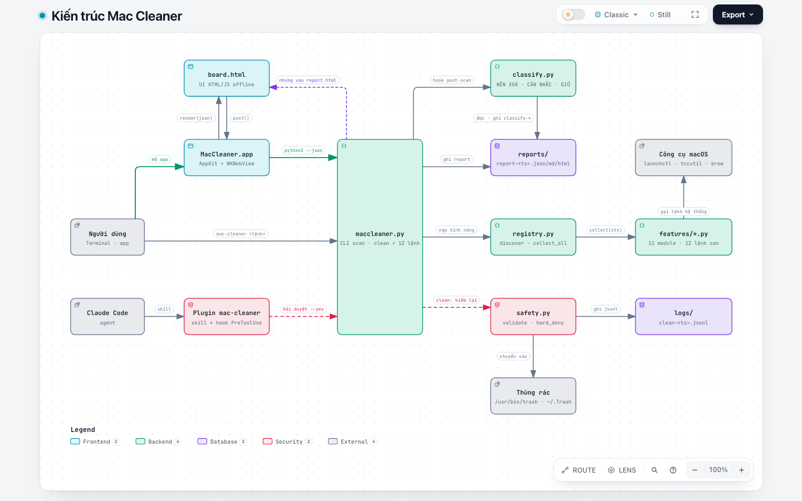

# Mac Cleaner — technical reference

For people who read the code, embed the dashboard in another app, or contribute. The user guide (install, update, using
the app and the command line) is the [README](../README.md).

1. [Architecture](#1-architecture)
2. [Requirements, build, test](#2-requirements-build-test)
3. [Repository layout](#3-repository-layout)
4. [Data sources](#4-data-sources)
5. [Safety tiers and the clean guard](#5-safety-tiers-and-the-clean-guard)
6. [Deletion paths](#6-deletion-paths)
7. [Post-scan hooks and classification](#7-post-scan-hooks-and-classification)
8. [Updating: `self-update` and `update.sh`](#8-updating-self-update-and-updatesh)
9. [Admin grants](#9-admin-grants)
10. [Embedding the board (host ↔ board protocol)](#10-embedding-the-board-host--board-protocol)
11. [Approval hook (Claude Code plugin)](#11-approval-hook-claude-code-plugin)
12. [Releases](#12-releases)
13. [Known limits](#13-known-limits)

## 1. Architecture

<picture>
  <source media="(prefers-color-scheme: dark)" srcset="architecture/architecture-dark.png">
  
</picture>

Interactive version (links to the source lines): [architecture/architecture.html](architecture/architecture.html) —
download it and open it in a browser.

- Three entry points share one core, `maccleaner.py`: the `mac-cleaner` command in a terminal, the Swift app (a
  `WKWebView` showing `board.html`; the JS bridge `post()` runs `python3 maccleaner.py … --json`), and the Claude Code
  plugin (a `PreToolUse` hook makes Claude ask before every `--yes` command).
- `scan` walks the root groups, then `registry.py` loads every file in `mclib/features/*.py` (subcommands +
  `report["features"]`). Features read machine state through macOS tools (`launchctl`, `sfltool`, `tccutil`, Spotlight,
  `brew`, `softwareupdate`…).
- The report is written to `reports/report-<ts>.{json,md,html}` (the HTML embeds `board.html`); then the `post-scan`
  hook runs `classify.py`.
- `clean` and `uninstall --yes` go through `safety.py`: every item is re-checked at run time, SIP / root folders /
  security software are hard-denied, items move to the Trash and `logs/clean-<ts>.jsonl` is written. The other
  state-changing commands (`startup`, `privacy reset`, `maintain run`) only act with `--yes`.

## 2. Requirements, build, test

macOS 13+, Python 3.9+ (standard library only), Swift 6.2+ for the app. The Python core has no third-party
dependency; the Swift app uses [SwiftTerm](https://github.com/migueldeicaza/SwiftTerm) for the embedded terminal
(SwiftPM fetches it at build time).

```sh
python3 maccleaner.py scan                       # scan → reports/report-<ts>.{html,md,json}, then hooks/post-scan/*
python3 maccleaner.py <subcommand> …             # every command of the user guide; `mac-cleaner` is a wrapper around this
swift run MacCleaner                             # desktop app from source: rescan, select, preview, clean in the UI
swift run MacCleaner --snapshot x.png            # render the latest report to an image, then exit
./scripts/make-app.sh && open build/MacCleaner.app          # Universal .app (ARCHS="arm64" for a faster one-arch build)
TMPDIR=/tmp python3 -m unittest discover tests   # unit tests
```

**Data directory** (`reports/`, `logs/`, `self-update.json`, `dumpbtm-cache.json`): `MACCLEANER_DATA` when set.
Otherwise the packaged `.app` uses `~/Library/Application Support/MacCleaner`, while `swift run` and a bare
`python3 maccleaner.py` write next to the source (`reports/`, `logs/`, both git-ignored). The `mac-cleaner` wrapper
that `install.sh` creates exports `MACCLEANER_DATA` to the Application Support folder, so the command and the app share
reports. Run the app on another data directory: `MACCLEANER_DATA=/some/dir open -a ~/Applications/MacCleaner.app`.

The app's terminal pane is a real PTY (SwiftTerm) running `tail -F` on `logs/app-<date>.log`; Ctrl-C drops to a login
shell in the data directory. The board has no log view of its own: embedded in another host, it sends the `terminal`
message and the host shows its own terminal (section 10).

## 3. Repository layout

```
maccleaner.py                  scan + clean + report output (Python stdlib, tested)
mclib/safety.py                shared guard: protected zones, hard deny of SIP/root folders, running apps, Trash, clean log
mclib/featclean.py             connects `clean` to feature items (--ids, --category <feature>[:<kind>])
mclib/registry.py              loads features from mclib/features/ (subcommands + report["features"]) — how to add one: mclib/README.md
mclib/features/                one file per feature: status, junk, maintain, space (analyze/large), dupes, cloud, uninstall, updates, startup, persistence (audit), privacy, selfupdate (self-update), admin
Web/board.html                 the whole UI (plain HTML/CSS/JS, offline) — used by the app and by the static report
Sources/MacCleaner/main.swift  AppKit window + WKWebView, JS bridge → maccleaner.py
scripts/make-app.sh            packages the Universal .app (arm64 + x86_64), ad-hoc signed
scripts/make-icon.swift        draws the app icon (same mark as the board logo) → assets/AppIcon.icns
install.sh                     one-command install: Command Line Tools, app, `mac-cleaner` command, Claude Code plugin
update.sh                      standalone updater/installer of the app from the latest release — works with every app version
skills/mac-cleaner/            the only skill: inventory + clean + monitor with mac-cleaner (plugin manifest in .claude-plugin/)
hooks/                         approval hook: Claude must ask before every real action (--yes), Mole without --dry-run, or the Trash
scripts/classify.py            classifies a report / the file system into NÊN XOÁ · CÂN NHẮC · GIỮ (runs after each scan)
hooks/post-scan/               hooks run right after a scan (10-classify)
tests/                         unit tests
docs/architecture/             architecture diagram (interactive HTML + light/dark images)
docs/CLEANMYMAC-PARITY.md      feature comparison with CleanMyMac
LICENSE                        MIT
```

## 4. Data sources

| Group | Source |
|---|---|
| applications | `/Applications`, `~/Applications`, `/System/Applications` — `Info.plist` (name, version, bundle id); App Store / manual / macOS |
| plugins | `pluginkit -mAvvv` (app extension + parent app), `{/,~/}Library/{Internet Plug-Ins, Audio/Plug-Ins, QuickLook, Spotlight, PreferencePanes, Input Methods, Services, …}`, `systemextensionsctl list` |
| extensions | `~/.<editor>/extensions/*/package.json` (every editor that stores extensions this way), `<Chromium browser>/<profile>/Extensions/<id>/<ver>/manifest.json` |
| git | `which -a git`, every folder with `.git` under `~` (skipping Library, node_modules, caches…) and `/opt/homebrew` — branch, remote, dirty file count, last commit, size of `.git` |
| caches | `~/Library/{Caches,Logs}`, `~/Library/Containers/*/Data/Library/Caches`, `/Library/{Caches,Logs}`, Xcode DerivedData/DeviceSupport/Archives, `simctl list devices unavailable`, `~/.npm`, `~/.gradle/caches`, `~/.cache/*`… |
| junk | build artifacts met while walking `~`, installers in Downloads/Desktop/Documents, backup files on the whole Data volume (`find -x`, grouped by folder + base name, the newest mtime is kept), Containers/Preferences matching no installed bundle id, the Trash |

Features in `mclib/features/` also read:

- `launchctl` / `sfltool dumpbtm` (startup, uninstall). `sfltool` needs admin authorization (macOS dialog "sfltool wants
  to make changes"), so since 1.11.3 the dialog only follows an explicit user action. `startup.dumpbtm(..., interactive=False)`
  (default; scans, autoclean, hooks, app/host runs) never makes the plain call: cached output for the current BTM
  signature, else `sudo -n` when `admin grant btm-read` is in place, else the last successful output marked `stale:`,
  else an error asking for `--refresh-btm` or the grant. `startup --refresh-btm` and `uninstall <app> --refresh-btm`
  pass `interactive=True` and may show the dialog. The cache file keeps the last good output (`good`) apart from the
  latest attempt (`last`), so a denied or cancelled run never overwrites good data. `admin grant btm-read --yes` removes
  the prompt for good (section 9).
- `codesign -dv` / the quarantine flag (persistence audit), the user's TCC.db (privacy), Spotlight
  `kMDItemLastUsedDate` (apps not opened for long), Sparkle appcasts + `brew outdated --cask` + `softwareupdate -l`
  (updates), `st_blocks` / `SF_DATALESS` (space, cloud).

Comparison with CleanMyMac: [CLEANMYMAC-PARITY.md](CLEANMYMAC-PARITY.md).

## 5. Safety tiers and the clean guard

| Tier | Meaning | Examples |
|---|---|---|
| `safe` | cleaning loses no data, the app recreates it | `~/Library/Caches/*` (macOS's own `com.apple.*` caches are `review`), `~/Library/Logs/*`, caches inside Containers, unavailable simulators, old backups (a newer one exists), obsolete editor extensions |
| `review` | cleanable, worth a look first | **Xcode DerivedData** (always proposed, never cleaned automatically — the next build is slower), build artifacts (node_modules, Pods, .venv…; used within 7 days → `info`), caches that take long to download again (`ms-playwright`, `JetBrains`), .dmg/.pkg/.xip installers, iOS DeviceSupport, Archives, `~/.cache/*`, old extension versions, app leftovers (Containers, Preferences, `Application Support/<bundle id>` — only when the app is gone, Spotlight does not find it either, and nothing was written for 30+ days), orphaned LaunchAgents (their program no longer exists), `/Library/Caches` |
| `info` | inventory (deletable when picked by id) | applications, plugins, extensions in use, git, the newest backup |
| `protected` | never cleaned automatically (only when picked by id) | caches that are live data: `~/Library/Caches/pypoetry` (virtualenvs), `org.R-project.R` (renv), `com.apple.FontRegistry`, `com.apple.Spotlight`; Keychains, `~/.ssh`, `~/.gnupg`; **every folder in `~/Library` other than** `Caches`, `Logs`, `Containers`, `Group Containers`, `Preferences`, `Developer` (application data, sync folders…); **every hidden folder in home other than** the cache areas `~/.cache`, `~/.npm`, `~/.gradle/caches` (data, models, configuration of tools) |

`clean` **re-checks every item at run time** and does not trust the report: the item must be `safe`/`review`, still
exist, not be protected, and sit in `~` (at least 2 levels deep) or `/Library/Caches`, `/Library/Logs`; the only
special command allowed is `xcrun simctl delete`.

`--force` (only together with `--ids`, i.e. picked by id) skips the tier and the protected zones but is **still
hard-denied** for:

- SIP and the system tree (`/System`, `/usr` outside `/usr/local`, `/bin`, `/sbin`, `/etc`, `/var`,
  `/Library/Keychains`, `/Library/Extensions`…);
- root folders (`/Applications`, `/Library/Application Support`, `/Users/*`, `/Users/Shared`, `/opt/homebrew`, `~`,
  `~/Documents`, `~/Library`…; compared case-insensitively because of APFS);
- **security / device-management software** (EDR, MDM — removing it can count as tampering);
- the folder Mac Cleaner itself runs from.

For a Trash item `--force` means emptying the Trash. Caches of a **running app** are skipped (`skip`) — quit the app,
then clean. Data of password managers, keychains, ssh/gpg, wallets and authenticator apps is never treated as a
"leftover". These guards were learned from how [Mole](https://github.com/tw93/mole) operates and rewritten for
mac-cleaner (no code copied).

## 6. Deletion paths

- **Trash (default).** `/usr/bin/trash` on macOS 15+; on macOS 13–14 the item is moved straight into `~/.Trash`.
  Recoverable until the Trash is emptied. Every run writes `logs/clean-<ts>.jsonl` (id, path, size, status, reason,
  mode per item).
- **Permanent (`clean --mode permanent`).** Each item passes every Trash check plus its own gate: only root-scan items
  that are `safe`/`review` with the move-to-Trash action, id matching the path, inside home at least 2 levels deep, real
  parent folder not pointing outside home; never combined with `--force`. The item is renamed into `~/.Trash` and then
  **exactly that moved copy** is removed — the original path is never deleted directly; on a failure half-way the rest
  stays in the Trash.
- **LaunchAgents** are stopped (`launchctl bootout`) before their plist moves to the Trash.
- **Emptying the Trash** is its own action (never part of a bulk delete); macOS may ask to let Mac Cleaner control
  Finder.
- **Board proposal popup.** Owned by the board and themed by it; the host only receives
  `clean:{"ids":[…],"mode":"trash"|"permanent","yes":true}`.
- **Static HTML report.** The delete buttons copy a `clean --ids …` command (with `--force` when an inventory item is
  included) to paste into a terminal.

## 7. Post-scan hooks and classification

After `scan`, every executable in `hooks/post-scan/` runs in name order with the report JSON as its argument
(`--no-hooks` turns this off). The default hook `10-classify` runs [scripts/classify.py](../scripts/classify.py): it
prints the summary table and the 5 largest NÊN XOÁ items, and writes everything to `reports/classify-<ts>.{md,json}`.

| Group | Meaning |
|---|---|
| **NÊN XOÁ** (delete) | recreated automatically (caches, logs, builds, dependencies, used installers) — deleting only costs rebuild time |
| **CÂN NHẮC** (consider) | deletable with a consequence: an app loses state/login/index, an SDK or simulator must be downloaded again, data of an app no longer used, emptying the Trash is permanent. Each item states what happens when it is deleted |
| **GIỮ** (keep) | system (SIP), user data, keys/secrets, Homebrew (left to `brew`), anything marked to keep |

- `--fs` walks from root to leaf: a folder matching a specific rule (`~/Library/Caches`, `*/node_modules`, `*/.build`…)
  is counted as one item with its whole tree; container folders (`~`, `~/Library`, `~/Documents`…) and places without
  a rule are descended into, down to `--depth` (default 6). `/System/Volumes` (the Data volume is already seen through
  firmlinks), `/Volumes` and `/dev` are skipped. `--root` (repeatable) limits the walk; `--out DIR` writes the files.
- Always-keep list: `--keep PATH` or the file named by `MACCLEANER_KEEP_FILE`. Cleaning history is read from
  `logs/clean-*.jsonl` (+ `MACCLEANER_EXTRA_LOGS`).
- Read-only: it deletes nothing. Cleaning still goes through `clean --ids … --yes`.

## 8. Updating: `self-update` and `update.sh`

Both read the latest GitHub release of this repository and only download over HTTPS from `github.com` /
`api.github.com` / `*.githubusercontent.com`.

Python's requests (`self-update`, and the Sparkle appcasts of `updates`) go through `updates.urlopen`: the default trust
store of the running Python plus the root bundle macOS ships (`/etc/ssl/cert.pem`). Since 1.11.2 — before that, a Python
with an empty store (a python.org build on which "Install Certificates.command" was never run) failed every check with
`CERTIFICATE_VERIFY_FAILED`. Certificates and host names are always verified. `update.sh` uses `curl`, which already
trusts the system roots.

**`self-update` (feature `mclib/features/selfupdate.py`, since 1.10.0)**

- `self-update check` asks `api.github.com` for the latest release; `self-update apply` previews the steps, `--yes`
  performs them.
- Git clone: `git fetch --tags`, fast-forward to exactly that tag, then `install.sh` again (refused while there are
  uncommitted changes).
- Downloaded app: fetch `MacCleaner-<version>-macos-universal.zip` + `.sha256` from the release; check SHA-256, bundle
  id, version and code signature; the old app goes to the Trash, then the new one takes its place.
- Scheduled check, **off by default and only with consent**: `self-update auto on --yes` (or the consent box in
  Settings) creates the user LaunchAgent `local.maccleaner.selfupdate`, daily or every Monday at the chosen time
  (`--every`, `--at`). Each run is one HTTPS request to `api.github.com` to read the version number; no machine data is
  sent. By default it only notifies; `--install` lets it install. `self-update auto off` removes the schedule.
- Settings live in `<data>/self-update.json`.
- **Schedules already on the machine** (since 1.11.0): `schedules(env)` reads the user's `~/Library/LaunchAgents/*.plist`
  (regular files only, no symlinks) and keeps an agent only when its label starts with `local.maccleaner.` — the
  identification every schedule made by Mac Cleaner carries (`local.maccleaner.selfupdate` is the update check). What
  the agent runs is not a criterion: since 1.11.1 another tool's job that calls mac-cleaner is never listed, edited or
  removed (1.11.0 also matched `ProgramArguments` and `MACCLEANER_*` environment keys). Each one gets a state:
  `current` (runs this install's `maccleaner.py`; for our own agent: arguments and environment equal what
  `build_agent` writes), `old` (another copy, or one that is gone), `custom` (no `maccleaner.py` argument, e.g. the
  command goes through the `mac-cleaner` wrapper). `self-update status --json` carries the
  list as `schedules`, so the app shows it at every start; `install.sh` prints it and `update.sh` names the agents
  whose `Label` has that prefix after an install.
  - `self-update schedule edit <label> [--every] [--at] --yes`: our own agent is written again by `auto on` (the time it
    had is kept unless given). Any other agent keeps its plist, except that every `…/maccleaner.py` argument becomes
    this install's script and, when a time is given, `StartCalendarInterval` replaces `StartInterval`. The agent is
    reloaded (`launchctl bootout` + `bootstrap`); if launchd refuses, the original bytes are written back and reloaded.
    Nothing to change (a `custom` agent without a new time) is an error, not a silent success.
  - `self-update schedule remove <label> --yes`: our own agent → `auto off`; any other → plist to the Trash, then
    `launchctl bootout`. Only labels that `schedules(env)` returned are accepted. Without `--yes` both commands preview.

**`update.sh` (repo root, any installed version)**

Apps older than 1.10.0 have no `self-update` subcommand, so the documented update command is a standalone script
fetched from `develop`:

```sh
curl -fsSL https://raw.githubusercontent.com/KmSlime/mac-cleaner/develop/update.sh | bash
curl -fsSL https://raw.githubusercontent.com/KmSlime/mac-cleaner/develop/update.sh | bash -s -- /path/to/MacCleaner.app
```

- Uses only tools that ship with macOS (`curl`, `shasum`, `ditto`, `codesign`, `PlistBuddy`, …); no Python, no sudo.
- Finds the app (argument → `~/Applications` → `/Applications`); none found → installs into `~/Applications`. A bundle
  whose id is not `local.maccleaner` is refused.
- Reads the latest tag from the redirect of `/releases/latest` (no API, no rate limit), downloads the zip + `.sha256`,
  checks SHA-256, bundle id, version and code signature. Only then the old app moves to `~/.Trash` and the new one is
  copied in; if that copy fails, the old app is moved back.
- Same or newer version installed → nothing happens.
- `MACCLEANER_RELEASES` (releases base URL) and `MACCLEANER_TAG` (pin a tag) exist for the tests
  (`tests/test_update_sh.py` runs the script against a local `file://` release with a temporary `HOME`).

The app at `~/Applications` and a clone holding the `mac-cleaner` command are two separate installs: updating from the
app (or with `update.sh`) replaces only the app; `mac-cleaner self-update apply --yes` from the clone updates both
(through `install.sh`). The app is ad-hoc signed, so after it is replaced macOS may ask again for privacy permissions
(Full Disk Access, Automation).

## 9. Admin grants

A few things need root: `sfltool dumpbtm` (reads login items — macOS asks for the password every time) and some
maintenance tasks. `admin grant <id> --yes` (or **Cấp** in Settings) shows the macOS administrator dialog **once** and
writes `/etc/sudoers.d/mac-cleaner`: one `NOPASSWD` line per command, for the current user only, with fixed arguments.
From then on mac-cleaner runs exactly that command through `sudo -n`.

| id | Granted command | Effect |
|---|---|---|
| `btm-read` | `sfltool dumpbtm` | read login items and background items, read-only |
| `dns-flush` | `dscacheutil -flushcache`, `killall -HUP mDNSResponder` | flush the DNS cache |
| `purge-ram` | `purge` | free the disk buffer cache |
| `spotlight-reindex` | `mdutil -E /` | rebuild the Spotlight index |
| `font-cache-system` | `atsutil databases -remove` | remove the font cache |

- No password is stored anywhere. An admin password kept in the Keychain with "Always Allow" is readable by every
  process of the user — root for everything, instead of root for exactly the five fixed commands above.
- The file is owned by root (0440) and checked with `visudo -c` before it is installed. `admin revoke <id>|all --yes`
  removes entries; with no grant left the file is deleted. `admin list` shows the state.
- Deliberately not grantable: `tmutil deletelocalsnapshots <date>` (free argument, cannot be undone) and `periodic`
  (runs scripts from folders a user may be able to write).

## 10. Embedding the board (host ↔ board protocol)

`Web/board.html` is self-contained; a host loads it in a web view and talks to it as follows.

| Direction | Call | Meaning |
|---|---|---|
| host → board | `window.render(report)` | show a report (after `scan --json` or from a `report-*.json` file); if `scanStarted` came before, the proposal popup opens |
| host → board | `window.scanStarted(first)` · `window.scanFailed(msg)` · `window.log(line)` | scan state (a `▸ …` line is the current step) |
| host → board | `window.cleaned(result)` | JSON of `clean --json` |
| host → board | `window.applyTheme({bg, surface, text, muted, accent, danger, ok, warn, info?, surface2?, line?, faint?, onAccent?, font?, mono?, scale?, dark})` | sync the theme (hex colors `#rrggbb`); `applyTheme(null)` restores the default. Not called → mac-cleaner's own theme |
| host → board | `window.openProposal()` | open the proposal popup |
| host → board | `window.settings(kind, action, result)` | answer to a `selfupdate:`/`admin:` message (the command's JSON, or `{"error": …}`). The Settings button appears only after the first call — a host without support simply never calls it |
| board → host | `scan` · `terminal` · `copy:<text>` · `reveal:<path>` · `clean:{"ids":[…],"mode":"trash"\|"permanent","yes":bool,"force":bool}` | through `webkit.messageHandlers.cleaner` |
| board → host | `selfupdate:{"action":"status"\|"check"\|"apply"\|"on"\|"off", "every", "at", "install", "consent"}` · `selfupdate:{"action":"schedule-edit"\|"schedule-remove", "label", "every"?, "at"?}` · `admin:{"action":"list"\|"grant"\|"revoke", "ids":[…]}` | the Settings drawer; `on` needs `consent: true`. `schedule-*` (since 1.11.0) act on one entry of `status.schedules`: the host validates `label` (`^[A-Za-z0-9][A-Za-z0-9._-]{0,119}$`) and runs `self-update schedule edit\|remove <label> … --yes --json`. A host that does not implement them should answer `window.settings("selfupdate", action, {"error": …})` so the button is released |

## 11. Approval hook (Claude Code plugin)

`hooks/hooks.json` registers a `PreToolUse` hook on `Bash` that runs `hooks/confirm-cleanup.sh`. Before the agent runs
a command that **really acts**, the hook answers "ask", so Claude Code must get the user's approval, auto mode
included:

- `mac-cleaner clean|uninstall … --yes`, `startup disable|enable … --yes`, `privacy reset … --yes`,
  `maintain run … --yes`, `self-update apply … --yes`, `self-update auto on … --yes`, `self-update schedule edit|remove … --yes`,
  `admin grant|revoke … --yes`;
- `mo clean|purge|uninstall|optimize|installer` without `--dry-run` (when the user installed Mole themselves);
- commands touching the Trash.

Preview commands pass through. The hook never hard-blocks: the decision always goes to the user.

## 12. Releases

- The version lives in one place, `mclib/__init__.py` (`__version__`); `scripts/make-app.sh` reads it and a test checks
  that `.claude-plugin/plugin.json` matches. It is shown under the app name in the
  board's sidebar (from `self-update status`; a static report shows the `version` field of the report, the version
  that wrote it), in the About panel (`CFBundleShortVersionString`) and by `maccleaner.py --version`.
- A release is an annotated tag `vX.Y.Z` on `develop` plus a GitHub Release. `main` is not kept in sync.
- Assets, whose names both updaters depend on:

```sh
./scripts/make-app.sh
ditto -c -k --keepParent build/MacCleaner.app MacCleaner-X.Y.Z-macos-universal.zip
shasum -a 256 MacCleaner-X.Y.Z-macos-universal.zip > MacCleaner-X.Y.Z-macos-universal.zip.sha256
```

- The bundle id is `local.maccleaner` and must stay so: `self-update` and `update.sh` refuse any other bundle.

## 13. Known limits

- No `sudo` beyond the fixed commands the user granted with `admin grant`: root-owned `/Library/Caches` and system
  caches may refuse; measuring the Trash needs Full Disk Access for the terminal.
- "Leftover" detection relies on the bundle ids of installed apps + plugins, so it can still confuse a helper/daemon
  → such items stay `review`.
- Sizes are `du -sk` estimates taken at scan time; for the space really freed compare `df` before/after (the CLI and
  the app both print it).
- The app is ad-hoc signed: a zip downloaded with a browser is quarantined and Gatekeeper blocks the first launch
  until the user opens it explicitly; replacing the app may reset privacy permissions.
